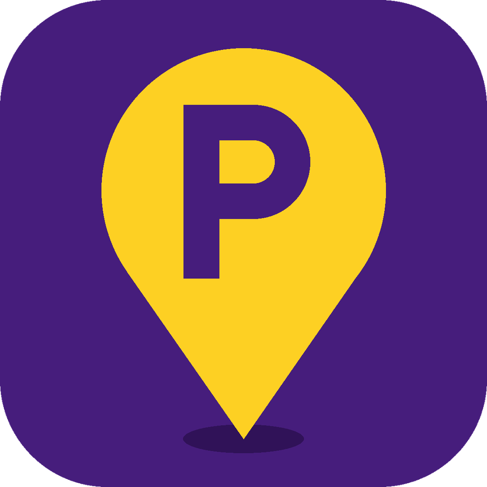
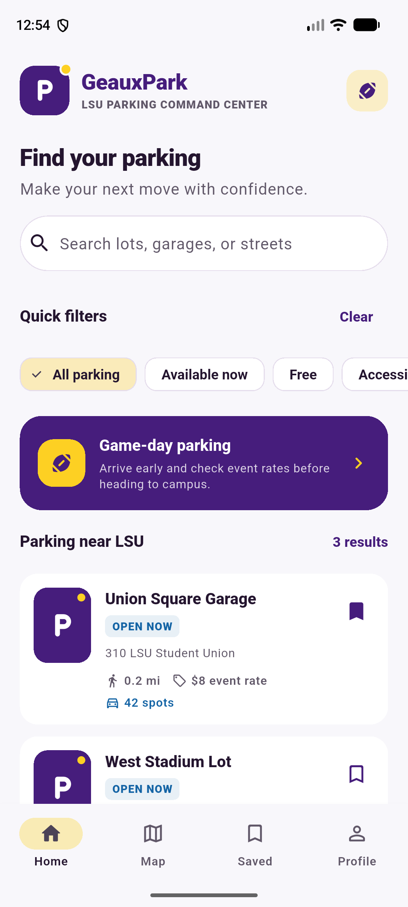
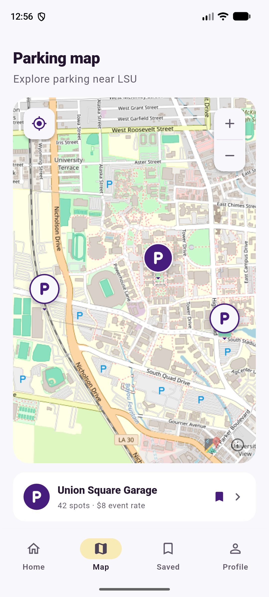
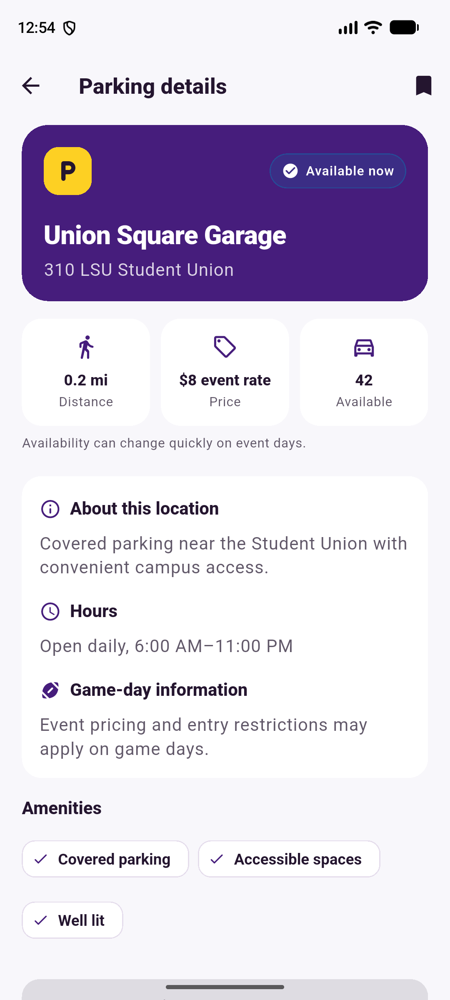
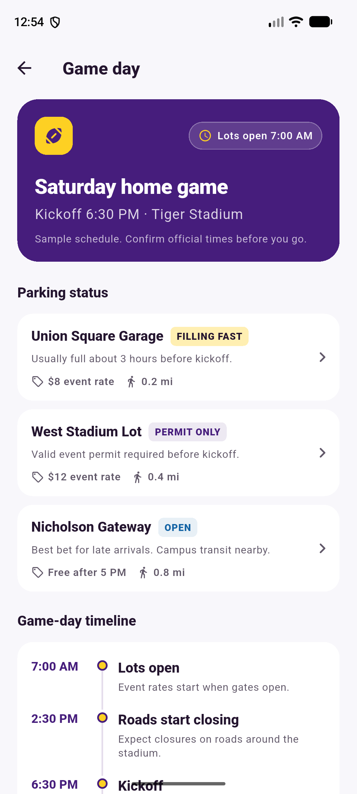
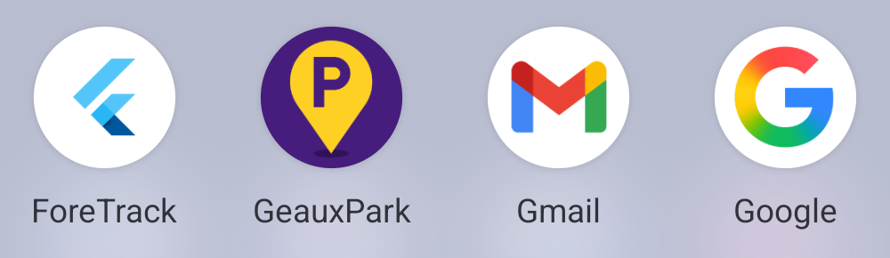

# GeauxPark design system

Every screen gets its colors, text styles, spacing, and corner radii from
[`lib/theme/app_theme.dart`](../../lib/theme/app_theme.dart). If you need a new
value, add it there instead of hardcoding it in a screen.

## Colors

| Token | Hex | Color scheme role | Used for |
|---|---|---|---|
| `AppColors.purple` | `#461D7C` | `primary` | Brand panels, headers, map pins, selected states |
| `AppColors.gold` | `#FDD023` | `secondary` | Accents, nav indicator, selected chips, timeline dots |
| `AppColors.actionBlue` | `#1464A5` | `tertiary` | Buttons, focus rings, "open" status, your location on the map |
| `AppColors.ink` | `#24152F` | `onSurface` | Main text |
| `AppColors.inkMuted` | `#615869` | `onSurfaceVariant` | Secondary text and captions |
| `AppColors.surface` | `#F8F7FB` | `surface` | App background |
| `AppColors.card` | `#FFFFFF` | — | Cards, inputs, search bar |
| `AppColors.border` | `#E5DDEC` | `outlineVariant` | Card, chip, and input borders |
| `AppColors.onPurpleMuted` | white 82% | — | Body text on purple panels |
| `AppColors.onPurpleSubtle` | white 70% | — | Timestamps and notes on purple panels |

In a widget, use `Theme.of(context).colorScheme.<role>`. Use `AppColors` only for
values that have no color scheme role.

### Status tags

| Status | Background | Text |
|---|---|---|
| OPEN / OPEN NOW | blue 10% | `tertiary` |
| FILLING FAST | gold 35% | `onSecondary` |
| PERMIT ONLY | purple 10% | `primary` |
| FULL | `errorContainer` | `onErrorContainer` |

## Text styles

Use the theme roles directly (`Theme.of(context).textTheme.titleMedium`). Change
the color if you need to, but don't change size or weight in a screen.

| Role | Size | Weight | Used for |
|---|---|---|---|
| `headlineSmall` | 24 | 900 | Screen titles, lot name on the details hero |
| `titleLarge` | 22 | 900 | Wordmark, empty and error states |
| `titleMedium` | 16 | 800 | Section headings, card titles |
| `bodyLarge` | 16 | 400 | Subtitles, paragraphs |
| `bodyMedium` | 14 | 400 | Default body text |
| `bodySmall` | 12 | 400 | Captions (muted color by default) |
| `labelLarge` | 14 | 800 | Values, counts, timeline times |
| `labelMedium` | 12 | 600 | Lot facts (distance, price) |
| `labelSmall` | 11 | 900 | Status tags (uppercase) |

## Spacing and radii

- Screen side padding: `AppSpacing.screen` (20).
- Spacing scale: 4 / 8 / 12 / 16 / 20 / 24 (`xs`, `sm`, `md`, `lg`, `screen`, `section`).
- Corner radii: tag 6, chip 12, button and input 16, card 18, hero panel 24.

## App icon



The icon is a gold map pin with a purple "P" on LSU purple. It's drawn with
geometry in [`tool/generate_app_icon.py`](../../tool/generate_app_icon.py), so
run that script to change it instead of editing the PNGs:

```bash
python tool/generate_app_icon.py
```

It writes the Android legacy icon, the adaptive icon's foreground and monochrome
(themed icon) layers, and the web icons. The adaptive background color is
`ic_launcher_background` in `android/app/src/main/res/values/`.

## Mockups

The mockups are screenshots of the running app on a Pixel 8 emulator
(1080 × 2400, 420 dpi), in [`mockups/`](mockups/).

| Home / list | Map | Lot details | Game day |
|---|---|---|---|
|  |  |  |  |

On the Pixel 8 launcher (adaptive icon, circle mask):



## Real-phone alignment checklist

Run through this on a physical Android phone before checking off the issue:

- [ ] Nothing is clipped under the status bar or the gesture bar on any tab.
- [ ] Lot cards: the name, OPEN NOW tag, and bookmark line up; long names end in "…".
- [ ] Filter chips scroll sideways without cutting off the last chip's border.
- [ ] Details: the three summary cards are the same height.
- [ ] Map: the zoom and location buttons don't overlap the map attribution.
- [ ] Game day: timeline dots line up with their times; status tags stay on one line.
- [ ] Turn on large text (Settings → Display → Font size, largest): no overflow
      stripes and nothing overlaps.
- [ ] The launcher icon looks right on the home screen, including with themed
      icons turned on (Android 13+).
